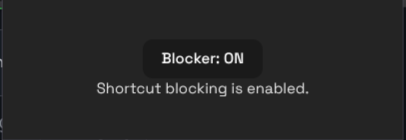
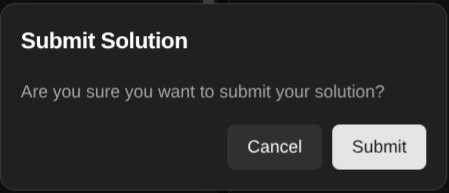
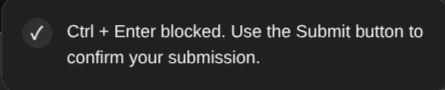

<p align="center">
  
</p>

<h1 align="center">Ctrln't</h1>

<p align="center">
  Prevent accidental submissions on LeetCode.
</p>

[](LICENSE)
[](https://github.com/vib404/ctrlnt/stargazers)
[](https://github.com/vib404/ctrlnt/releases/latest)

## Features
- Block LeetCode's `Ctrl` + `Enter` shortcut to avoid accidental submissions.
- A modal will pop up when you click the Submit button.
- You can disable these safety features anytime from the extension.

As we are habitual of misclicking when we try to run code, we accidentally click Submit, and sometimes we are used to pressing `Ctrl` + `Enter` to go to new lines. These accidental submissions reduce the Acceptance Rate.
## Screenshots




## Installation and Usage

### Requirements

- Google Chrome or a Chromium-based browser.
- Access to [LeetCode](https://leetcode.com/).

## Installation

1. Download the latest `ctrlnt.zip` from the [GitHub Releases](https://github.com/vib404/ctrlnt/releases) page.
2. Extract the ZIP file.
3. Open `chrome://extensions` in your browser.
4. Enable **Developer mode**.
5. Click **Load unpacked**.
6. Select the extracted extension directory containing `manifest.json`.

## How to Use

1. Open a problem on LeetCode.
2. Click the extension icon to enable or disable Ctrln't using its toggle.
3. When enabled, clicking **Submit** opens a confirmation modal. Confirm to submit your solution, or cancel to return without submitting.
4. Pressing **Ctrl + Enter** while the code editor is present is blocked, and a toast notification appears.

When Ctrln't is disabled, it does not intercept the Submit button or block the Ctrl + Enter shortcut.

## Development

### Clone the Repository

```bash
git clone https://github.com/vib404/ctrlnt.git
cd ctrlnt
```

### Install Dependencies

```bash
bun install
```

### Start Development

```bash
bun run dev
```

This starts the development environment for the extension.

### Production Build

```bash
bun run build
```

The production build for Chrome is generated in `.output/chrome-mv3/`.

### Load the Built Extension

1. Open `chrome://extensions` in Chrome.
2. Enable **Developer mode**.
3. Click **Load unpacked**.
4. Select the `.output/chrome-mv3/` directory.

## Known Limitations

- Ctrln't is designed for LeetCode.
- Behavior may change if LeetCode updates its interface or submission controls.

## Contributing

Contributions, bug reports, and suggestions are welcome. Please open an issue to report a bug or discuss a proposed change before submitting a pull request.

1. Fork the repository.
2. Create a branch for your changes.
3. Make and test your changes.
4. Open a pull request with a clear description.

## License

See the [`LICENSE`](LICENSE) file for the terms under which this project is distributed.
